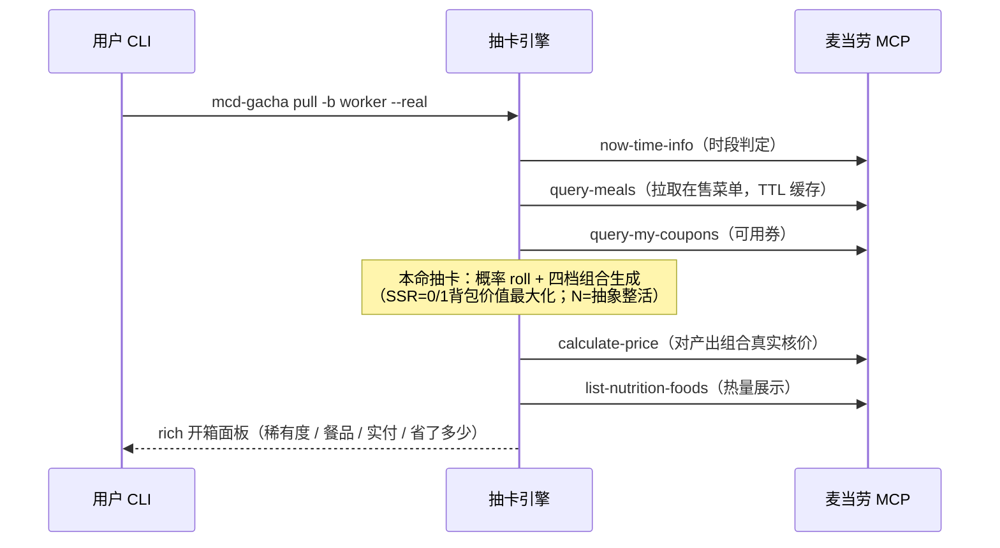
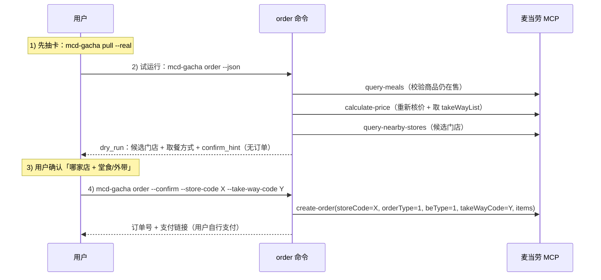

# MCP 集成说明（MCP_INTEGRATION）

本文档说明 Mcd-Gacha 如何真实使用麦当劳 MCP Server 能力。
（含 2026-10-10 真实 Token 联调实测结论，服务版本 mcd-mcp v1.0.0 / 协议 2025-06-18）

## 1. 接入信息

| 项目 | 内容 |
|------|------|
| MCP Server | 麦当劳中国 MCP 服务（官方） |
| 接入地址 | `https://mcp.mcd.cn` |
| 传输协议 | Streamable HTTP |
| 鉴权方式 | 请求头 `Authorization: Bearer ${MCD_MCP_TOKEN}` |
| 限流 | 600 请求 / 分钟（429 需退避） |
| 官方文档 | [M-China/mcd-mcp-server](https://github.com/M-China/mcd-mcp-server) |

Token 通过环境变量 `MCD_MCP_TOKEN`、项目根 `.env` 或本地配置
（`mcd-gacha config set-token`）提供，**绝不写入代码仓库**；
脱敏配置示例见 [mcp-config.example.json](mcp-config.example.json)。

### 门店解析（到店取餐场景）

抽卡前需确定门店（真实菜单按门店返回）：

- 方式一（推荐）：`mcd-gacha config set-store --city 深圳市`（自动选择最近门店）；
- 方式二：`mcd-gacha config set-store --store-code 1421182`（固定门店，编号可用 `mcd-gacha stores` 查询）；
- 解析实现：`query-nearby-stores(beType=1, searchType=2, city=<城市>, keyword="麦当劳")`；
- 到店自取场景（beType=1）不需要 `beCode`，`orderType=1, beType=1` 即可。

## 2. 使用的 MCP Tool 及用途

| Tool | 本项目用途 | 调用时机 |
|------|-----------|----------|
| `now-time-info` | 获取当前时间，判定「深夜玄学宵夜池」（21:00–04:00）是否开放 | 每次抽卡前 |
| `query-meals` | 拉取当前门店可售餐品列表（编码、分类、价格、标签），作为卡池选品池 | 每次会话（TTL 缓存 10 分钟） |
| `calculate-price` | 对抽出的餐品组合**真实核价**（原价、优惠、应付），保证「省了多少钱」有据可依 | 每次抽卡 |
| `list-nutrition-foods` | 查询抽卡结果的热量/营养信息，展示在开箱面板与分享卡 | 每次抽卡 |
| `query-my-coupons` / `query-store-coupons` | 查询账户可用券，参与「最优券规划」（SSR 的叠券压价玩法） | 每次会话 |
| `query-nearby-stores` / `delivery-query-addresses` | 定位/选择门店上下文（部分工具依赖门店） | 会话初始化 |
| `create-order` | `mcd-gacha order --confirm` 提交订单（默认 dry-run，**不会调用本接口**）。到店场景必传 `takeWayCode`，取值来自 `calculate-price` 的 `takeWayList` | 用户明确执行 `order --confirm` 时 |

## 3. 调用流程（一次典型抽卡）

**调用预算**：单次抽卡 MCP 请求 < 5 次，十连复用会话级菜单缓存（≤ 12 次），
远低于 600 次/分钟限流。

## 4. 安全闸门设计

「下单」是项目中的**唯一写操作**，采用三层闸门：

1. **默认 dry-run**：`mcd-gacha order` 不加 `--confirm` 时只做试运行——重新核价、打印将要提交的组合，
   并返回**候选门店**与**取餐方式**列表，**不调用 `create-order`**；
2. **显式确认 + 地点/取餐方式确认**：只有加 `--confirm` 才真正提交订单；提交前必须让用户确认
   「去哪个门店（`--store-code`）」与「怎么取（`--take-way-code`：堂食 / 外带）」——
   抽卡阶段不打扰用户，只在**下单这一步**问；
3. **只提交、不代付**：命令返回订单号与支付链接，**支付由用户在麦当劳官方渠道自行完成**。

配套约束：

- 演示模式（mock）抽出的组合是虚拟 SKU，`order` 会直接拒绝，避免产生无效订单；
- 当前仅实现**到店自取**（`beType=1 / orderType=1`）下单；外送 / 得来速 / 团餐会明确报错，而不是半成品提交；
- 到店下单**必传 `takeWayCode`**，取值来自 `calculate-price` 返回的 `data.takeWayList[].code`
  （2026-10-10 实测：`eat-in` 堂食 / `locker-in` 外带）；未取到时报错并可用 `--take-way-code` 手动指定；
- 门店可在下单时用 `--store-code` 覆盖本地配置；候选门店列表来自 `query-nearby-stores`
  （`order --city <城市>` 可切换搜索城市）。

### 4.1 一次典型下单

## 5. 错误处理与降级

| 场景 | 行为 |
|------|------|
| 未配置 Token | 自动使用内置演示菜单（离线可玩），并提示配置方式 |
| 未配置门店 | 提示 `mcd-gacha config set-store --city <城市>`，并回退演示数据 |
| 401（Token 无效） | 提示检查 `MCD_MCP_TOKEN`，回退演示数据 |
| 429（限流） | 指数退避重试；仍失败则回退演示数据 |
| 商品售罄/不可售 | 核价失败 → 自动重新生成组合（最多 4 次尝试），保证单次抽卡稳定 |
| 网络异常/接口变更 | 回退演示数据，界面明确标注「内置快照」而非真实数据 |

所有真实数据与演示数据在输出中有明确区分（`--json` 的 `data_source` 字段为 `mcp` / `mock`）。

## 5.1 联调实测记录（2026-10-10）

真实 Token 联调中发现并解决的问题（均已固化进代码）：

1. **价格口径**：`query-meals` 返回 `currentPrice`（现价）与 `originalPrice`（原价）。
   实测确认——`canWithOrder=true` 的活动类商品（"四件套/分享餐"等"随心选"组合）
   裸核价按**原价**计算；其余商品核价按**现价**。
   本项目的数据源转换采用**与核价一致的价格**，保证「本地预算校验 = 服务端核价」，
   抽卡组合永不超预算（这是 `engine` 层"预算不变量"的数据基础）。
2. **实时售罄**：商品会在会话期间变为不可售（核价返回"商品已售罄或不可售"），
   因此 `engine` 采用「生成 → 核价 → 失败/超预算则重新生成」的重试循环（≤4 次）。
3. **非餐品与限定商品过滤**：周边（毛绒/徽章/联名袋）、限定人群商品（"学生专享"）
   会出现在菜单接口中，已通过关键词过滤，保证抽卡组合都是真实可点的餐品。
4. **营养匹配**：`list-nutrition-foods` 返回 160 项全量营养表（CSV 文本），
   按商品名精确/归一化匹配填充热量。

## 6. 业务价值

「中午吃什么」是高频、低价值的决策消耗。本项目把麦当劳 MCP 的
**菜单查询 + 核价 + 优惠券 + 营养** 能力，包装成决策娱乐化入口：

1. **降低决策成本**：一抽定午饭，结束选择困难；
2. **优惠可感知**：真实核价 + 最优券规划，让「省了多少」看得见；
3. **社交传播**：抽卡结果可生成分享卡，天然适合在工作群里传播，为麦当劳带来自然的品牌好感场景；
4. **营养透明**：热量随抽卡结果展示，帮助用户在娱乐中选择。

## 7. 合规与脱敏说明

- 本文档与代码库中不含任何真实 Token、密钥或个人信息；
- 示例配置仅使用环境变量占位符（`${MCD_MCP_TOKEN}`）；
- 本项目为非官方第三方开源玩具，不与麦当劳存在隶属或背书关系；
- 数据来源声明：菜单与价格以麦当劳官方渠道实时结果为准，内置快照仅用于离线演示。
