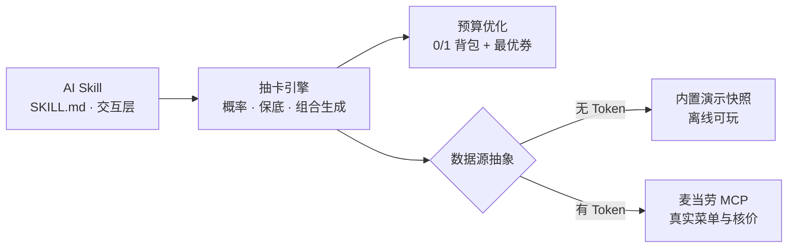

```
  ███╗   ███╗ ██████╗██████╗      ██████╗  █████╗  ██████╗██╗  ██╗ █████╗
  ████╗ ████║██╔════╝██╔══██╗    ██╔════╝ ██╔══██╗██╔════╝██║  ██║██╔══██╗
  ██╔████╔██║██║     ██║  ██║    ██║  ███╗███████║██║     ███████║███████║
  ██║╚██╔╝██║██║     ██║  ██║    ██║   ██║██╔══██║██║     ██╔══██║██╔══██║
  ██║ ╚═╝ ██║╚██████╗██████╔╝    ╚██████╔╝██║  ██║╚██████╗██║  ██║██║  ██║
  ╚═╝     ╚═╝ ╚═════╝╚═════╝      ╚═════╝ ╚═╝  ╚═╝ ╚═════╝╚═╝  ╚═╝╚═╝  ╚═╝
```

<div align="center">

# 🍟 MCD-Gacha · 麦门抽卡模拟器

**一个 AI Skill：用二游抽卡机制决定「中午吃什么」**

> 「中午不知道吃什么？对 AI 说一声「抽一发」，把工位命运交给一顿预算内的单抽。」

<p align="center">
  
</p>

[](LICENSE)
[](#-这是一个-ai-skill)
[](#-卡池与概率)
[](#-保底规则)
[](MCP_INTEGRATION.md)
[](#-安全与合规)

**简体中文** | [English](README_EN.md)

</div>

---

> ⚠️ **本项目为非官方第三方开源玩具**，与麦当劳官方无隶属关系。餐品信息、价格与供应状态以麦当劳官方渠道的实时结果为准。

## 💭 为什么用「抽卡」而不是推荐算法？

面对麦当劳几十个在售餐品，选择困难症的真实成本不是「不知道有什么」，而是**「决定不了吃什么」**：

- 想省钱，但一张张翻券、算门槛很累；
- 想控制预算，但「主食+配餐+饮料」的组合是人算不过来的；
- 好不容易点完，又开始纠结「是不是点贵了」。

推荐算法给出的是「你可能喜欢」——那只是又一个待决策项，负担并没有减轻。
**抽卡给的是一份已经满足预算约束的完整搭配**，而且附带一个说得出口的理由：「命运选的」。

- 一抽定午饭，决策成本归零；
- 「10 发保底」和保底进度条，让摸鱼时间有了目标感；
- 抽到金卡可以截图晒群——选择困难症的解法，也可以是一种工位娱乐。

> 随机不是为了偷懒，而是——在几十个选项里，把「选不动」变成「抽一下」。

## 🎰 这是什么？

把「中午吃什么」的选择困难症，包装成**二游抽卡**，做成一个可装进 AI 智能体的 **Skill**：

- 🎴 **三个卡池**：吃土经济学常驻池 / 打工人回血限定 UP 池 / 深夜玄学宵夜池（21:00-04:00 限时）
- ✨ **四档稀有度**：金卡（欧皇金光）→ 紫卡 → 蓝卡 → 隐藏灰卡（抽象艺术）
- 🛡️ **10 发硬保底**：连续 9 发未出金，第 10 发必出金
- 🔨 **重铸玩法**：不满意组合里某一件？同品类重铸换一件（优先升级/平价），**不消耗保底进度**
- 💰 **真实核价**：接入[麦当劳 MCP Server](MCP_INTEGRATION.md)，菜单与价格来自官方接口（也可离线试玩）
- 🛒 **可下单（安全闸门）**：把抽到的组合提交给官方 MCP。**先抽卡，下单时再确认地点和取餐方式**——默认只试运行并列出候选门店 + 取餐方式，用户明确确认后才真正下单并回显支付链接
- 🧾 **晒卡利器**：抽卡结果一键生成像素风 SVG 分享卡，随手发群
- ⚖️ **概率透明**：内置蒙特卡洛自证命令，出率随时可验证
- 🖱️ **对话式收尾**：每次抽完用**可点击选项**（十连 / 重铸一件 / 下单 / 看保底进度）承接下一步，不用打字

## 🧩 这是一个 AI Skill

本项目只提供**一种形态：AI Skill**。把仓库作为 Skill 装进 WorkBuddy / Claude 等支持 Skill 的 Agent，
之后对本地说「**抽一发**」「**帮我决定午饭**」「**把午饭交给命运**」即可触发——
`SKILL.md` 是 Skill 的完整定义（触发词、命令编排、结果转写规则、合规红线）。

```
Skill（SKILL.md · 交互层）  ──调用──▶  Python 引擎（src/mcd_gacha/ · 能力底座）
        │                                        │
   触发识别 / 结果转写 /                  概率 · 保底 · 组合生成
   可点击收尾 / 合规红线                  · 预算优化 · MCP 核价
```

- **Skill 是交互层**：负责把自然语言翻译成引擎命令，再把 JSON 结果转写成友好卡片；
- **Python 引擎是能力底座**：承载全部概率、保底、组合生成、核价与下单逻辑，Skill 通过 `uvx` 调用；
- 两者是**同一套引擎**的一体两面：Skill 不含独立规则，改概率/卡池只需改引擎的 `banners.json`。

## 🚀 30 秒上手

**第 1 步：把本仓库装为 Skill**

将本仓库放入 WorkBuddy / Claude 等 Agent 的 **skills 目录**（或以 Skill 形式导入），
`SKILL.md` 即为其定义。WorkBuddy 用户也可在对话中直接引用本仓库技能。

**第 2 步：对 AI 说话就行**

```text
你：抽一发
AI：━━━ 开 箱 ━━━ …（此处为抽卡结果）…
    [十连] [重铸一件] [下单] [看保底进度]
```

**第 3 步（可选）：切换真实菜单**

默认使用**内置演示菜单，零配置离线可玩**。若要体验真实菜单与在线核价，
按 [`MCP_INTEGRATION.md`](MCP_INTEGRATION.md) 配置 `MCD_MCP_TOKEN` 即可，失败会自动回退演示数据。

> 🌐 无需安装任何东西 —— Skill 内部用 `uvx --from git+https://github.com/pzweuj/mcd-gacha mcd-gacha …`
> 零安装拉起引擎命令；已安装 `mcd-gacha` 时则直接用本地命令。

## 🎮 体验预览

```text
━━━ 开 箱 ━━━
╭──────────── SSR · 金卡 · 欧皇时刻 ✨ ────────────╮
│                                                  │
│  🍔 巨无霸           ¥25.5                        │
│  🍟 中薯条           ¥12.5                        │
│  🥤 可口可乐（中）    ¥9.5                         │
│                                                  │
│  原价 ¥47.5  →  券后 ¥39.5（满40减8 · 省 ¥8）      │
│  总热量 1040 kcal                                 │
│                                                  │
╰──────────────────────────────────────────────────╯
  欧皇时刻！这套价格，连店员都想拍照。
  保底进度 ░░░░░░░░░░ 0/10（再抽 10 发内必出金）
```

## 🎴 卡池与概率

| 卡池 | 预算 | 特色 | 开放时间 |
|------|------|------|----------|
| 🍟 吃土经济学 · 常驻池 | ¥8–15 | 卡在预算线内的快乐 | 全天 |
| 🍔 打工人回血 · 限定 UP 池 | ¥25–40 | 必含招牌大件（巨无霸/安格斯） | 全天 |
| 🌙 深夜玄学 · 宵夜池 | ¥15–35 | 咖啡因与宵夜的玄学搭配 | 21:00–04:00 |

| 稀有度 | 基础概率 | 组合特征 | 视觉 |
|--------|---------|----------|------|
| **SSR（金卡）** | 5% | 预算内价值最大化 + 最优券，性价比之王 | ✨ 金光 |
| **SR（紫卡）** | 25% | 经典热销正餐（主+配+饮） | 💜 紫光 |
| **R（蓝卡）** | 60% | 规矩的一顿（1+1 随心配 / 主+配） | 💙 蓝光 |
| **N（隐藏款）** | 10% | 抽象整活：意料之外的搭配艺术 | 🩶 灰光 |

### 保底规则

- 每个卡池**独立计数**：连续 9 发未出金，第 10 发**必出金**；出金后计数清零。
- 十连 = 顺序 10 次单抽，共享计数器。

### 📢 概率透明声明

基础出金率 5% 叠加 10 发硬保底后，**SSR 有效出率约 12.5%**（平均约 8 抽一金）。
不信？自己验（Skill 亦可代跑）：

```bash
mcd-gacha simulate -n 100000 --seed 42
```

```
🎲 蒙特卡洛模拟（100,000 次 seed=42）
 SSR   基础 5%   实测 12.40%
 ⛳ SSR 平均间隔 8.06 抽；最大间隔 10 抽；保底触发 7,855 次
```

## 🔨 重铸玩法

抽到的组合里有一件不想要？**重铸**它——二游式「锁定重铸」：

```text
你：第二件不要，重铸一下
AI：🔨 重铸第 2 件：“辣”么快乐套餐 → 麦香鸡套餐
```

- **同品类替换**：只换指定件（可乐换可乐位、汉堡换汉堡位），其余卡面保持；
- **优先升级/平价**：候选里有更好的先试，实在放不下才降级；
- **不消耗保底**：重铸是「工艺」不是抽卡——保底进度条纹丝不动；
- **预算硬约束**：重铸后组合仍在预算内（券后实付 ≤ 预算）。

## 📦 安装与配置

### 🧩 安装 Skill（唯一形态）

将本仓库作为 Skill 目录装进你的 Agent：

```text
<你的 Agent skills 目录>/
└── mcd-gacha/
    ├── SKILL.md      # Skill 定义（第一步读这个）
    └── …             # 底层引擎（Skill 通过 uvx 调用，无需手动安装）
```

装好后，直接对 AI 说「抽一发」即可，其余交给 Skill。

### 🔗 真实 MCP 模式（可选）

默认使用内置演示菜单（离线可玩）。若要体验**真实菜单与在线核价**：

1. 在 [麦当劳 MCP 开放平台](https://open.mcd.cn/mcp) 申请 MCP Token；
2. 配置 Token（三选一）：
   - 环境变量：`export MCD_MCP_TOKEN=你的Token`
   - 项目根 `.env` 写入：`MCD_MCP_TOKEN=你的Token`
   - 本地保存：`mcd-gacha config set-token 你的Token`
3. 配置门店（到店取餐，二选一）：
   - `mcd-gacha config set-store --city 深圳市`（自动选择最近门店）
   - `mcd-gacha config set-store --store-code 1421182`（固定门店；编号可用 `mcd-gacha stores --city 深圳市` 查询）

MCP 接入细节（工具清单、调用流程、价格口径与安全设计）见 [MCP_INTEGRATION.md](MCP_INTEGRATION.md)。

### ⚙️ 引擎底座（进阶，可选）

Skill 内部通过 `uvx` 免安装调用引擎；若你希望本机常驻一条更短的 `mcd-gacha` 命令
（调试、脚本自动化或离线排查），可自行安装引擎：

```bash
uv tool install git+https://github.com/pzweuj/mcd-gacha   # 或 pipx install …
pip install "mcd-gacha[mcp]"                              # 真实 MCP 模式所需（可选）
```

<details>
<summary>引擎命令一览（供 Skill 调用 / 进阶调试）</summary>

| 命令 | 说明 |
|------|------|
| `mcd-gacha pull` | 单抽（`-b` 选卡池，`--budget` 定预算，`--real` 真实 MCP，`--json` 输出 JSON） |
| `mcd-gacha ten` | 十连（共享保底计数器） |
| `mcd-gacha reroll --slot N` | 重铸第 N 件（同品类替换，不耗保底） |
| `mcd-gacha order` | 下单最近一次组合：默认**试运行**并列出候选门店 + 取餐方式；`--confirm --store-code <编号> --take-way-code <堂食/外带>` 才真正提交 |
| `mcd-gacha banners` | 卡池一览与开放状态 |
| `mcd-gacha status` | 保底进度与生涯统计 |
| `mcd-gacha simulate` | 蒙特卡洛概率自证 |
| `mcd-gacha doctor` | 环境自检（Token 来源 / 门店 / MCP 连通性） |
| `mcd-gacha stores` | 查询附近门店（真实模式用） |
| `mcd-gacha config set-token` | 保存 MCP Token（仅存本地） |
| `mcd-gacha config set-store` | 保存门店（城市或门店编号） |

</details>

## 🏗️ 架构



- **单一形态**：Skill 是唯一面向用户的入口；Python 引擎是被 Skill 调用的能力底座；
- **数据源抽象**：`MockDataSource`（内置快照）与 `McpDataSource`（真实 MCP）同协议，随时切换、失败自动回退；
- **组合生成**：四档稀有度对应四种策略，统一出口校验「券后实付 ≤ 预算」；
- **参数单一真源**：概率 / 卡池 / 预算集中在 `banners.json`，Skill 与引擎共用。

## 🛡️ 安全与合规

- **下单需显式确认，且先确认地点与取餐方式**：`order` 默认只做**试运行**（dry-run，不产生订单）并列出候选门店与取餐方式；必须由用户明确确认后才真正调用 `create-order`；命令只返回订单号与支付链接，**支付由用户在麦当劳官方渠道自行完成**，本项目不代付；
- **Token 安全**：Token 仅存本地（环境变量 / `.env` / 本地配置），不进版本库，示例配置只含环境变量占位符；
- **非官方声明**：本项目为第三方开源玩具，非麦当劳官方产品；请理性消费、快乐生活。

## 🚧 当前限制（诚实清单）

本项目遵循「文档不假装已完成」原则——以下是有意不做或尚未覆盖的部分：

**有意不做**

- ❄️ **不自动下单 / 不代付**：抽卡与核价默认全程只读；下单必须显式确认且只负责提交订单、回显支付链接——支付与退款一律走麦当劳官方渠道；
- 🎯 **不做营养/医疗建议**：热量数据仅供娱乐参考，不构成膳食建议；
- 🧮 **不做全量忌口系统**：组合生成不排除过敏原（麦当劳 MCP 未提供结构化过敏原字段），有严格忌口需求请以官方菜单标注为准。

**受上游能力限制**

- 📍 门店查询为城市级（麦当劳 MCP 不接受经纬度），无法按真实距离排序门店；
- 🍔 菜单随门店与时段实时变化，内置演示快照与实际菜单存在时间差（输出中已标注数据来源）；
- 💳 优惠券以账号实际可用为准；无券账号的「省」显示为 0（这是真实状态，不是 bug）。

**尚未完成（路线图内）**

- 🖼️ 分享卡 PNG 一键导出（SVG 原生支持；PNG 需可选依赖 cairosvg）。

## 🤝 参与贡献

欢迎 Issue / PR：新卡池点子、文案梗、分享卡模板、真实 MCP 联调反馈都收。

**如果这个玩具让你会心一笑，点个 ⭐ Star 就是最好的打赏。**

## 📄 License

[MIT](LICENSE) © 2026 Mcd-Gacha contributors
