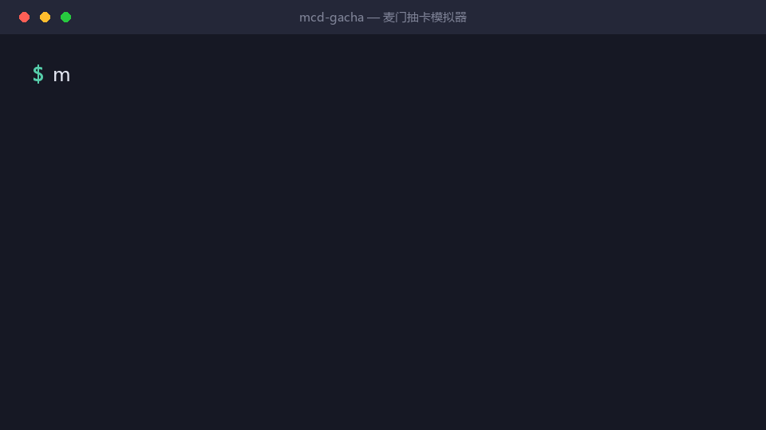
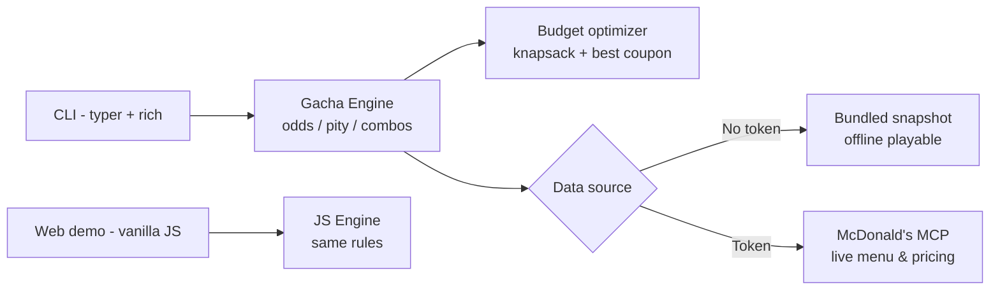

# 🍟 MCD-Gacha · McDonald's Gacha Simulator

> "Can't decide what to eat for lunch? Let fate pick a combo — within your budget."

A zero-setup gacha toy that turns "what should I have for lunch" decision paralysis into a
two-minute gacha ritual — four rarity tiers, a 10-pull hard pity, budget-constrained combo
optimization, and (optionally) **live pricing from the official McDonald's China MCP Server**.

<p align="center">
  
</p>

<div align="center">

[](#-installation)
[](LICENSE)
[](#-banners--probabilities)
[](#-pity-rules)
[](MCP_INTEGRATION.md)
[](#-compliance)

[简体中文](README.md) | **English**

</div>

---

> ⚠️ **Unofficial fan project.** Not affiliated with or endorsed by McDonald's.
> Prices and availability are subject to the official McDonald's channels.

## 💭 Why a gacha, not a recommender?

With dozens of items on the menu, the real cost of decision paralysis isn't
"not knowing what's there" — it's **"being unable to decide"**:

- Coupons have thresholds; doing the math while hungry is exhausting;
- A balanced "main + side + drink" combo within budget is hard to reason about;
- After ordering, the second-guessing begins: *"was that too expensive?"*

A recommender hands you *"you might like X"* — just another decision to make.
**A gacha pull hands you a complete combo that already satisfies every constraint**,
with a story you can say out loud: *"fate picked it."*

- One pull decides lunch; decision cost drops to zero;
- A pity counter ("N pulls until guaranteed gold") turns idle time into a mini-game;
- Pulled an SSR? Save the share card and flex in the group chat.

> Randomness isn't laziness — it's turning *"can't decide"* into *"just pull one"*.

## 🎰 What is this?

- 🎴 **Three banners**: Thrift Economics (≤¥15) / Worker Recovery UP (¥25–40) / Midnight Mystic (21:00–04:00)
- ✨ **Four rarity tiers**: Gold (SSR) → Purple (SR) → Blue (R) → Hidden Grey (N, "abstract art")
- 🛡️ **10-pull hard pity**: 9 non-SSR pulls guarantee the 10th is SSR, per banner
- 🔨 **Reforge**: dislike one item in your combo? Reforge it in the same category (upgrade-first), pity untouched
- 💰 **Live pricing**: via the [McDonald's MCP Server](MCP_INTEGRATION.md) — or fully offline with bundled demo data
- 🧾 **Share card**: pixel-style SVG card generated from each pull
- ⚖️ **Transparent odds**: built-in `simulate` Monte Carlo self-verification

## 🧩 Three ways to play (same engine)

| Form | How | Best for |
|------|-----|----------|
| 🧩 **AI Skill** | Install this repo as a Skill in WorkBuddy / Claude, then just say "pull one for lunch" (see [`SKILL.md`](SKILL.md)) | Chat-driven slackers |
| ⌨️ **CLI** | `uvx --from git+https://github.com/pzweuj/mcd-gacha mcd-gacha pull` | Terminal geeks & scripting |
| 🌐 **Web demo** | **[Play instantly](https://pzweuj.github.io/mcd-gacha/)** — zero install, flip-card animation | The curious passer-by |

## 🚀 Quick start

**Option 0: Play in your browser** → <https://pzweuj.github.io/mcd-gacha/>

**Option 1: Try with zero config (bundled demo menu, no token needed)**

```bash
# Requires uv (https://docs.astral.sh/uv/)
uvx --from git+https://github.com/pzweuj/mcd-gacha mcd-gacha pull
```

**Option 2: Install locally**

```bash
uv tool install git+https://github.com/pzweuj/mcd-gacha
# or: pipx install git+https://github.com/pzweuj/mcd-gacha
```

```bash
mcd-gacha pull                # single pull (auto-selects banner by time of day)
mcd-gacha ten -b worker       # 10-pull on the Worker UP banner
mcd-gacha reroll --slot 2     # reforge the 2nd item of your last combo
mcd-gacha simulate -n 100000  # verify the odds yourself
```

## 🎴 Banners & probabilities

| Banner | Budget | Feature | Hours |
|--------|--------|---------|-------|
| 🍟 Thrift Economics | ¥8–15 | Maximum value under a tight budget | 24/7 |
| 🍔 Worker Recovery UP | ¥25–40 | Must include a premium item (Big Mac / Angus) | 24/7 |
| 🌙 Midnight Mystic | ¥15–35 | Coffee & late-night pairings | 21:00–04:00 |

| Rarity | Base rate | Combo style |
|--------|-----------|-------------|
| **SSR (Gold)** | 5% | Max-value combo within budget + best coupon |
| **SR (Purple)** | 25% | Classic full meal (main + side + drink) |
| **R (Blue)** | 60% | Regular order (1+1 deals / main + side) |
| **N (Hidden Grey)** | 10% | Abstract art: unexpected but edible combos |

### Pity rules

Per-banner counter: after 9 consecutive non-SSR pulls, the 10th is **guaranteed SSR**.
A 10-pull shares one counter. Reforging does **not** consume pity.

### 📢 Transparent odds statement

Base 5% + 10-pull hard pity ⇒ **effective SSR rate ≈ 12.5%** (one gold every ~8 pulls on average).
Don't trust us — verify:

```bash
mcd-gacha simulate -n 100000 --seed 42
# SSR  ~12.40%   max gap: 10 pulls   pity triggers: 7,855
```

## 🔨 Reforge

Dislike an item? Reforge it — a "locked reforge" in gacha terms:

```bash
$ mcd-gacha reroll --slot 2
  🔨 Reforge #2: "Spicy Joy Combo" → McSpicy Chicken Combo
```

Same category only, upgrade-or-equal preferred, budget always respected, **pity untouched**.

## 📦 Installation

```bash
uv tool install git+https://github.com/pzweuj/mcd-gacha        # uv (recommended)
pipx install git+https://github.com/pzweuj/mcd-gacha           # pipx
pip install git+https://github.com/pzweuj/mcd-gacha            # pip (in a venv)
```

### 🔗 Real MCP mode (optional)

1. Get an MCP Token at <https://open.mcd.cn/mcp> (China mainland);
2. Provide the token: env var `MCD_MCP_TOKEN`, a `.env` file, or `mcd-gacha config set-token <TOKEN>`;
3. Set your store: `mcd-gacha config set-store --city 深圳市` (or `--store-code 1421182`);
4. `pip install "mcd-gacha[mcp]"` then `mcd-gacha pull --real`.

`mcd-gacha doctor` diagnoses token/network/store issues in one shot.
See [MCP_INTEGRATION.md](MCP_INTEGRATION.md) for tools used and call flow.

## 🕹️ Commands

| Command | Description |
|---------|-------------|
| `mcd-gacha pull` | Single pull (`-b` banner, `--budget`, `--real`, `--json`, `--save-card`) |
| `mcd-gacha ten` | 10-pull (shared pity counter) |
| `mcd-gacha reroll --slot N` | Reforge the Nth item (same category, pity-safe) |
| `mcd-gacha order` | Submit the last combo (**dry-run by default**, listing candidate stores + take-away options; `--confirm --store-code <id> --take-way-code <code>` actually places it) |
| `mcd-gacha banners` | Banner list & availability |
| `mcd-gacha status` | Pity progress & career stats |
| `mcd-gacha simulate` | Monte Carlo odds verification |
| `mcd-gacha doctor` | Environment self-check |
| `mcd-gacha stores` | Nearby stores (real mode) |
| `mcd-gacha config set-token / set-store` | Local config |

## 🏗️ Architecture



- **Data-source abstraction**: `MockDataSource` vs `McpDataSource` behind one protocol; auto-fallback;
- **Single source of truth**: probabilities/banners live in `banners.json`, shared by CLI & web;
- **Zero deps in the web demo**: vanilla JS engine mirroring the Python rules (tested with `node --test`).

## 🛡️ Safety & compliance

- **Ordering requires explicit confirmation — and confirms location + take-away first**: pull first, then `mcd-gacha order` runs a dry-run by default and lists candidate stores and take-away options; only `--confirm` (optionally with `--store-code` / `--take-way-code`) calls `create-order`. It returns the order id and a payment link — **you pay in McDonald's official channel**, this project never pays for you;
- **Token safety**: token stays local (env / `.env` / local config), never committed;
- **Unofficial**: fan-made toy, not a McDonald's product.

## 🚧 Known limitations (honest list)

**By design**

- ❄️ No auto-ordering, no payments — `order` requires an explicit `--confirm` (after you pick a store and a take-away option) and only returns a payment link;
- 🎯 Nutrition data is for fun, not dietary advice;
- 🧮 No allergen filtering (the MCP API exposes no structured allergen data).

**Upstream constraints**

- 📍 Store lookup is city-level (MCP accepts no coordinates);
- 🍔 Menus change by store & time; the bundled snapshot may differ (data source is labeled in output).

## 🤝 Contributing

Issues & PRs welcome: banner ideas, copywriting, share-card templates, real-MCP feedback.

**If this toy made you smile, a ⭐ Star is the best tip.**

## 📄 License

[MIT](LICENSE) © 2026 Mcd-Gacha contributors
