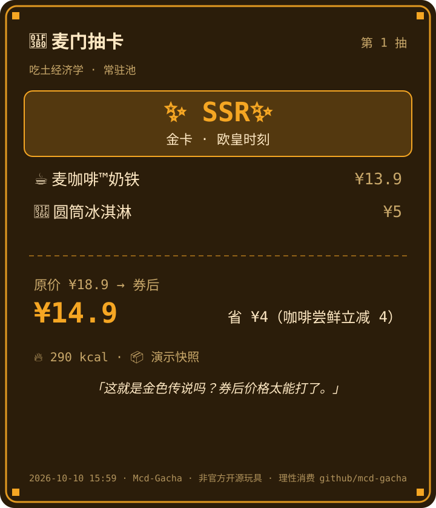
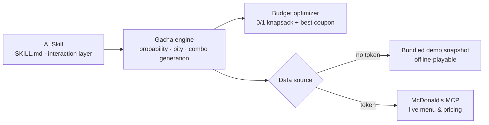

```
  ███╗   ███╗ ██████╗██████╗      ██████╗  █████╗  ██████╗██╗  ██╗ █████╗
  ████╗ ████║██╔════╝██╔══██╗    ██╔════╝ ██╔══██╗██╔════╝██║  ██║██╔══██╗
  ██╔████╔██║██║     ██║  ██║    ██║  ███╗███████║██║     ███████║███████║
  ██║╚██╔╝██║██║     ██║  ██║    ██║   ██║██╔══██║██║     ██╔══██║██╔══██║
  ██║ ╚═╝ ██║╚██████╗██████╔╝    ╚██████╔╝██║  ██║╚██████╗██║  ██║██║  ██║
  ╚═╝     ╚═╝ ╚═════╝╚═════╝      ╚═════╝ ╚═╝  ╚═╝ ╚═════╝╚═╝  ╚═╝╚═╝  ╚═╝
```

<div align="center">

# 🍟 MCD-Gacha · McDonald's Gacha Simulator

**One AI Skill: let a gacha pull decide "what's for lunch"**

> "Can't decide what to eat for lunch? Tell your AI *'pull one'* — let fate pick a combo within your budget."

<p align="center">
  
</p>

[](LICENSE)
[](#-this-is-an-ai-skill)
[](#-banners--probabilities)
[](#-pity-rules)
[](MCP_INTEGRATION.md)
[](#-safety--compliance)

**English** | [简体中文](README.md)

</div>

---

> ⚠️ **Unofficial fan project.** Not affiliated with or endorsed by McDonald's.
> Prices and availability are subject to the official McDonald's channels.

## 💭 Why a gacha, not a recommender?

With dozens of items on the menu, the real cost of decision paralysis isn't
"not knowing what's there" — it's **"being unable to decide"**:

- Coupons have thresholds; doing the math while hungry is exhausting;
- A balanced "main + side + drink" combo within budget is hard to reason about;
- After ordering, the second-guessing begins: *"was that too expensive?"*

A recommender hands you *"you might like X"* — just another decision to make.
**A gacha pull hands you a complete combo that already satisfies every constraint**,
with a story you can say out loud: *"fate picked it."*

- One pull decides lunch; decision cost drops to zero;
- A pity counter ("N pulls until guaranteed gold") turns idle time into a mini-game;
- Pulled an SSR? Save the share card and flex in the group chat.

> Randomness isn't laziness — it's turning *"can't decide"* into *"just pull one"*.

## 🎰 What is this?

Decision paralysis about lunch, wrapped as a **two-minute gacha ritual** and shipped as an
**AI Skill** you drop into an agent:

- 🎴 **Three banners**: Thrift Economics (≤¥15) / Worker Recovery UP (¥25–40) / Midnight Mystic (21:00–04:00)
- ✨ **Four rarity tiers**: Gold (SSR) → Purple (SR) → Blue (R) → Hidden Grey (N, "abstract art")
- 🛡️ **10-pull hard pity**: 9 non-SSR pulls guarantee the 10th is SSR, per banner
- 🔨 **Reforge**: dislike one item in your combo? Reforge it in the same category (upgrade-first), pity untouched
- 💰 **Live pricing**: via the [McDonald's MCP Server](MCP_INTEGRATION.md) — or fully offline with bundled demo data
- 🛒 **Ordering (with safety gates)**: submit the pulled combo to the official MCP. **Pull first, confirm location + pickup method only at order time** — dry-run by default, and it only submits after the user explicitly confirms, returning the order id and pay link
- 🧾 **Share card**: pixel-style SVG card generated from each pull
- ⚖️ **Transparent odds**: built-in Monte Carlo self-verification
- 🖱️ **Click-to-continue**: every pull ends with clickable options (10-pull / reforge one / order / view pity) — no typing required

## 🧩 This is an AI Skill

The project ships in **exactly one form: an AI Skill.** Drop this repo into WorkBuddy / Claude
(or any Skill-capable agent), then just say *"pull one"*, *"pick my lunch"* or
*"let fate decide lunch"* — `SKILL.md` is the complete Skill definition (triggers, command
orchestration, result-rendering rules, compliance red lines).

```
Skill (SKILL.md · interaction layer)  ──calls──▶  Python engine (src/mcd_gacha/ · capability core)
        │                                                   │
   trigger detection / rendering /                 probability · pity · combo generation
   click-to-continue / red lines                   · budget optimizer · MCP live pricing
```

- **The Skill is the interaction layer**: it translates natural language into engine commands, then renders the JSON into a friendly card;
- **The Python engine is the capability core**: it carries all probability, pity, combo generation, pricing and ordering logic, invoked by the Skill via `uvx`;
- They are **two faces of one engine**: the Skill holds no rules of its own — change a probability or a banner and only the engine's `banners.json` changes.

## 🚀 Quick start

**Step 1 — Install as a Skill**

Place this repository in your agent's **skills directory** (or import it as a Skill);
`SKILL.md` is its definition. WorkBuddy users can also reference this skill directly in chat.

**Step 2 — Just talk to your AI**

```text
You: pull one
AI:  ━━━ OPEN ━━━ … (your pull result appears here) …
     [10-pull] [Reforge one] [Order] [View pity]
```

**Step 3 (optional) — Switch to the real menu**

By default the Skill uses a **bundled demo menu — zero config, fully offline**. To get the
real menu and live pricing, set `MCD_MCP_TOKEN` as described in
[`MCP_INTEGRATION.md`](MCP_INTEGRATION.md); on any failure it falls back to demo data automatically.

> 🌐 Nothing to install — internally the Skill runs
> `uvx --from git+https://github.com/pzweuj/mcd-gacha mcd-gacha …`
> to boot the engine with zero setup; if `mcd-gacha` is already installed, it uses the local command.

## 🎮 Preview

```text
━━━ OPEN ━━━
╭──────────── SSR · Gold · Legendary ✨ ────────────╮
│                                                   │
│  🍔 Big Mac             ¥25.5                      │
│  🍟 Medium Fries        ¥12.5                      │
│  🥤 Coca-Cola (M)       ¥9.5                       │
│                                                   │
│  Was ¥47.5  →  Now ¥39.5 (¥8 off · saved ¥8)       │
│  Total 1040 kcal                                  │
│                                                   │
╰───────────────────────────────────────────────────╯
  Legendary! Even the cashier wants a photo.
  Pity ░░░░░░░░░░ 0/10 (guaranteed gold within 10 pulls)
```

## 🎴 Banners & probabilities

| Banner | Budget | Highlight | Hours |
|--------|--------|-----------|-------|
| 🍟 Thrift Economics · Standard | ¥8–15 | Happiness on a shoestring | All day |
| 🍔 Worker Recovery · Limited UP | ¥25–40 | Always includes a signature (Big Mac / Angus) | All day |
| 🌙 Midnight Mystic · Late-night | ¥15–35 | Caffeine and late-night mysticism | 21:00–04:00 |

| Rarity | Base rate | Combo profile | Look |
|--------|-----------|---------------|------|
| **SSR (Gold)** | 5% | Max value within budget + best coupon | ✨ Gold |
| **SR (Purple)** | 25% | Classic best-selling meal (main + side + drink) | 💜 Purple |
| **R (Blue)** | 60% | A by-the-book meal (1+1 / main + side) | 💙 Blue |
| **N (Hidden)** | 10% | Abstract chaos: unexpected combinations | 🩶 Grey |

### Pity rules

- **Counted per banner**: 9 non-SSR pulls in a row guarantee the 10th is **SSR**; the counter resets on an SSR.
- A 10-pull is 10 sequential single pulls sharing the same counter.

### 📢 Odds transparency

A 5% base rate plus a 10-pull hard pity puts the **effective SSR rate at ~12.5%** (about one gold every 8 pulls).
Don't take our word for it (the Skill can run this for you):

```bash
mcd-gacha simulate -n 100000 --seed 42
```

```
🎲 Monte Carlo (100,000 runs, seed=42)
 SSR   base 5%   measured 12.40%
 ⛳ SSR mean gap 8.06 pulls; max gap 10; pity triggered 7,855 times
```

## 🔨 Reforge

Not happy with one item in your combo? **Reforge** it — the gacha-style "locked reforge":

```text
You: drop the 2nd item and reforge it
AI:  🔨 Slot 2 reforged: "Spicy" Happy Meal → McChicken Meal
```

- **Same-category swap**: only the target slot changes (a drink swaps for a drink, a burger for a burger);
- **Upgrade-first**: try something better first, only downgrade as a last resort;
- **Pity untouched**: reforge is a "craft", not a pull — the pity bar doesn't move;
- **Budget still hard-capped**: the combo stays within budget after reforge (paid ≤ budget).

## 📦 Install & configure

### 🧩 Install the Skill (the only form)

Drop this repo into your agent's Skill directory:

```text
<your agent skills dir>/
└── mcd-gacha/
    ├── SKILL.md      # Skill definition (read this first)
    └── …             # underlying engine (invoked by the Skill via uvx; no manual install)
```

Then just say "pull one" — the rest is handled by the Skill.

### 🔗 Real MCP mode (optional)

The bundled demo menu is the default (offline-playable). For the **real menu and live pricing**:

1. Apply for an MCP token at the [McDonald's MCP open platform](https://open.mcd.cn/mcp);
2. Configure the token (three options):
   - Env var: `export MCD_MCP_TOKEN=your-token`
   - Project-root `.env`: `MCD_MCP_TOKEN=your-token`
   - Local store: `mcd-gacha config set-token your-token`
3. Configure a store (for pickup, pick one):
   - `mcd-gacha config set-store --city 深圳市` (auto-pick the nearest store)
   - `mcd-gacha config set-store --store-code 1421182` (fixed store; find the code with `mcd-gacha stores --city 深圳市`)

For MCP details (tool list, call flow, pricing semantics and safety design), see [MCP_INTEGRATION.md](MCP_INTEGRATION.md).

### ⚙️ Engine base (advanced, optional)

The Skill boots the engine via `uvx` with no install; if you'd rather have a permanent, shorter
`mcd-gacha` command locally (for debugging, scripting or offline checks), install the engine yourself:

```bash
uv tool install git+https://github.com/pzweuj/mcd-gacha   # or: pipx install …
pip install "mcd-gacha[mcp]"                              # required for real MCP mode (optional)
```

<details>
<summary>Engine command reference (used by the Skill / for advanced debugging)</summary>

| Command | Description |
|---------|-------------|
| `mcd-gacha pull` | Single pull (`-b` banner, `--budget`, `--real` live MCP, `--json`) |
| `mcd-gacha ten` | 10-pull (shares the pity counter) |
| `mcd-gacha reroll --slot N` | Reforge the Nth slot (same category, pity untouched) |
| `mcd-gacha order` | Order the latest combo: **dry-run** by default and lists candidate stores + pickup methods; add `--confirm --store-code <code> --take-way-code <eat-in/take-out>` to submit |
| `mcd-gacha banners` | List banners and open status |
| `mcd-gacha status` | Pity progress and lifetime stats |
| `mcd-gacha simulate` | Monte Carlo odds self-check |
| `mcd-gacha doctor` | Environment self-check (token source / store / MCP connectivity) |
| `mcd-gacha stores` | Query nearby stores (real mode) |
| `mcd-gacha config set-token` | Save the MCP token (local only) |
| `mcd-gacha config set-store` | Save the store (city or store code) |

</details>

## 🏗️ Architecture



- **Single form**: the Skill is the only user-facing entry point; the Python engine is the capability core it calls;
- **Data-source abstraction**: `MockDataSource` (bundled snapshot) and `McpDataSource` (live MCP) share one protocol — switch anytime, fall back automatically on failure;
- **Combo generation**: four rarity tiers map to four strategies, all gated by "paid ≤ budget";
- **Single source of truth**: probabilities / banners / budgets live in `banners.json`, shared by the Skill and the engine.

## 🛡️ Safety & compliance

- **Ordering requires explicit confirmation, and location + pickup method come first**: `order` defaults to a **dry-run** (no order created) and lists candidate stores and pickup methods; `create-order` is only called after the user explicitly confirms. The command returns the order id and pay link — **payment is completed by the user on McDonald's official channels**; this project never pays on your behalf;
- **Token safety**: the token is stored locally only (env var / `.env` / local config), never committed; the example config contains placeholders only;
- **Unofficial**: this is a third-party fan toy, not an official McDonald's product. Spend sensibly and have fun.

## 🚧 Known limitations (honest list)

This project follows a "docs don't pretend work is done" rule — here's what we deliberately skip or haven't covered:

**Deliberately not done**

- ❄️ **No auto-ordering / no payment**: pulls and pricing are read-only throughout; ordering must be explicitly confirmed and only submits the order and returns the pay link — payment and refunds go through McDonald's official channels;
- 🎯 **No nutrition/medical advice**: calorie data is for fun only, not dietary advice;
- 🧮 **No full allergen system**: combo generation does not exclude allergens (the McDonald's MCP exposes no structured allergen field); check official menu labels if you have strict dietary needs.

**Limited by upstream**

- 📍 Store lookup is city-level (the McDonald's MCP accepts no lat/long), so stores can't be ranked by real distance;
- 🍔 The menu varies by store and time of day; the bundled demo snapshot may lag the live menu (the output labels the data source);
- 💳 Coupons depend on your account; accounts with no coupons show "saved 0" (that's the real state, not a bug).

**Not yet done (on the roadmap)**

- 🖼️ One-click PNG export of the share card (SVG is native; PNG needs the optional cairosvg dependency).

## 🤝 Contributing

Issues / PRs welcome: new banner ideas, copy gags, share-card templates, and real MCP integration feedback.

**If this toy made you smile, a ⭐ Star is the best tip.**

## 📄 License

[MIT](LICENSE) © 2026 Mcd-Gacha contributors
